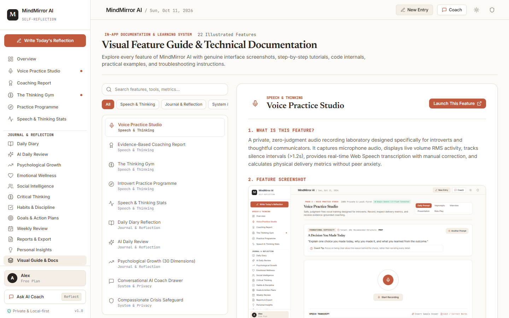

# MindMirror AI — Personal Communication & Thinking Coach for Introverts

<p align="center">
  
  
  
  
  
  
  
</p>

> **Private Vocal Practice × Evidence-Based Delivery Metrics × The Thinking Gym × 5-Stage Desensitization Curriculum**

MindMirror AI is an evidence-based personal communication practice studio, cognitive reasoning gym, and psychological reflection platform. Engineered specifically for introverts and thoughtful communicators, MindMirror provides a private, zero-judgment studio, deterministic delivery metrics (WPM, fillers, pauses), structured argument rubrics (the PREP framework), and longitudinal growth tracking.

---

## 📸 Genuine UI Gallery (1440 × 900 Desktop Viewport)

| Overview Dashboard | Voice Practice Studio |
| :---: | :---: |
|  |  |
| **Evidence-Based Coaching Report** | **The Thinking Gym** |
|  |  |
| **Introvert Practice Programme** | **In-App Visual Documentation** |
|  |  |

*(Explore all 23 genuine interface captures in the [Screenshot Catalog Index](docs/screenshot-index.md))*

---

## 📚 Complete Documentation Library

- 📖 **[Beginner's Guidebook](docs/beginner-guide.md)** — Step-by-step tutorial for getting started, running the app on any device, and practicing daily.
- 🎯 **[User-Facing Feature Reference](docs/feature-reference.md)** — Comprehensive breakdown of all 22 modules with genuine screenshots, inputs, outputs, and examples.
- 💻 **[Code-Level Function Reference](docs/function-reference.md)** — Detailed technical documentation for all core functions, services, and API endpoints.
- 📸 **[Screenshot Index](docs/screenshot-index.md)** — Visual catalog of all 22 genuine 1440×900 UI captures.
- 🏗️ **[System Architecture](docs/architecture.md)** — Deep dive into Web Audio processing, multi-provider AI waterfall cascades, and privacy models.
- 🧪 **[Testing & QA Guide](docs/testing.md)** — Automated test execution, schema validation, and verification matrices.
- 🛠️ **[Troubleshooting Guide](docs/troubleshooting.md)** — Quick fixes for microphone access, port conflicts, and offline fallback mode.

---

## 🌟 Core Modules

### 1. 🎙️ Voice Practice Studio
- **100% Private Recording Canvas**: Web Audio API volume visualizer (`AudioContext` + `AnalyserNode`), session timer, start/pause/stop, and live audio playback.
- **5 Structured Practice Modes**:
  1. *Daily Speaking Prompts* (low-friction reflection)
  2. *Impromptu Speaking* (rapid framing with randomized refresher)
  3. *Interview Practice* (STAR framework: Situation, Task, Action, Result)
  4. *Presentation Practice* (executive summaries & proposals)
  5. *Conversation Role-Play* (assertive boundary setting & feedback)
- **Live Speech Transcription**: Real-time speech streaming via Web Speech API with an editable correction editor.
- **Deterministic Delivery Metrics**:
  - **Speaking Pace (WPM)**: Evaluated against the optimal conversational band (130–165 WPM).
  - **Filler Frequency**: Strict case-insensitive tokenization (*um*, *uh*, *like*, *you know*, *basically*, *actually*, etc.) calculated per 100 words.
  - **Pause & Cadence Analysis**: Silence intervals (>1.2s) measured via audio RMS levels.

### 2. 📋 Evidence-Based Coaching Reports
Every practice session generates an empirical, constructive coaching report featuring:
1. **PREP Structure Assessment**: Point, Reason, Example, and Point checkmarks.
2. **Strengths with Verbatim Quotes**: Specific phrases demonstrating clarity or impact.
3. **Ranked Weaknesses by Priority**: Prioritized by listener cognitive friction, with verbatim evidence and impact explanations.
4. **Clearer Alternative Response**: A rewritten, 4-part PREP model answer.
5. **Targeted Micro-Drills**: 2–3 specific drills (e.g., *The Silent Pause Drill*, *60-Second PREP Challenge*).
6. **Measurable Retest Criterion**: Single-click retest launcher targeting specific delivery goals.

### 3. 🧠 The Thinking Gym
Structured reasoning exercises across 10 analytical domains, evaluated with explicit rubrics that reward justified conclusions and intellectual honesty:
1. *Critical & Logical Thinking* (spotting false causes and fallacies)
2. *Fact vs. Opinion & Assumption Detection*
3. *Evidence Evaluation & Argument Construction* (Claim-Evidence-Reasoning)
4. *Cognitive Biases & Alternative Explanations*
5. *First-Principles & Systems Thinking*
6. *Creativity & Lateral Thinking* (inversion thinking)
7. *Problem-Solving & Decision-Making* (reversible vs. irreversible decisions)
8. *Probabilistic Reasoning & Uncertainty* (asymmetric risk)
9. *Perspective-Taking & Respectful Disagreement* (steel-manning)
10. *Metacognition & Self-Reflection* (auditing defensive reactivity)

### 4. 🧭 Introvert Practice Programme
A 5-stage progressive desensitization pathway:
- **Stage 1**: Private Speaking Practice (solo vocalization comfort).
- **Stage 2**: Clear & Structured Answers (PREP framing).
- **Stage 3**: AI Conversation Role-Play (tolerating silence & active listening).
- **Stage 4**: Group & Interview Simulations (multi-stakeholder syncs).
- **Stage 5**: Real-World Practice Challenges (transferring studio skills to everyday conversations).

### 5. 📈 Longitudinal Progress Dashboard
- Line chart of speaking pace (WPM) against the 130–165 WPM target band.
- Bar chart of filler word density reduction over time.
- Recurrence tracker identifying persistent strengths and priority focus areas.
- Complete practice log history with session reports and retest tracking.

---

## 🔒 Security, Privacy & Reliability Guardrails

1. **Audio Sovereignty & Privacy**: Audio recordings are processed locally in the browser memory (`Blob`). Users can permanently delete the audio recording at any time with a single click (*Delete Audio*).
2. **Server-Side API Keys**: All AI keys (`GEMINI_API_KEY`, `GROQ_API_KEY`, etc.) remain exclusively on the server in `.env`.
3. **Explicit Evidence Guardrail**: Pace (WPM), filler frequency, and pauses are directly measured from physical audio timing and transcript tokens.
4. **Resilient Multi-Provider Fallback**: `gemini-2.5-flash` &rarr; `groq` &rarr; `cerebras` &rarr; `ollama` &rarr; `local_heuristic`. Never crashes when internet or external API quotas are exhausted.
5. **Mental Health Safety Interceptor**: Real-time detection of self-harm expressions displays immediate 24/7 hotline resources (988 US/Canada, 111 UK, 13 11 14 Australia).

---

## 🚀 Quick Start & Installation

### Prerequisites
- Node.js `v18+` or `v20+`
- npm `v9+` or `v11+`

### Setup & Run
```bash
# 1. Clone the repository
git clone https://github.com/bhanuatla521-svg/MindMirror-AI-.git
cd MindMirror-AI-

# 2. Install dependencies
npm install

# 3. Setup environment keys
cp .env.example .env

# 4. Start the backend AI server (Port 3001)
npm run server

# 5. In a second terminal, start the frontend UI (Port 3000)
npm run dev
```

Open **`http://localhost:3000`** in your browser.

---

## 🧪 Running the Tests

```bash
# Production bundle & TypeScript typecheck
npm run build

# AI backend, budget, and deduplication test suite
npm run test:ai

# Speech metrics and Thinking Gym test suite
npx tsx server/test-speech.ts
```

---

## 🤝 Contributing & Security

- Contributions are welcome! Read our **[Contributing Guidelines](CONTRIBUTING.md)** for branch conventions and PR instructions.
- Review our **[Security & Privacy Policy](SECURITY.md)** for vulnerability reporting.
- Track updates in our **[Changelog](CHANGELOG.md)**.

---

## 📄 License

This project is licensed under the **MIT License** — see the [LICENSE](LICENSE) file for details.
