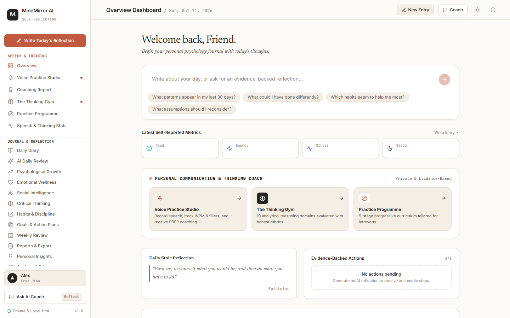
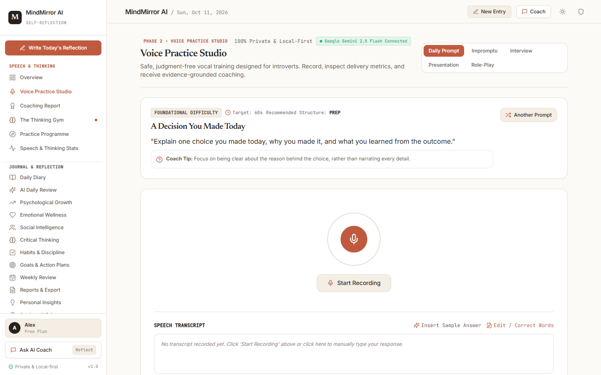
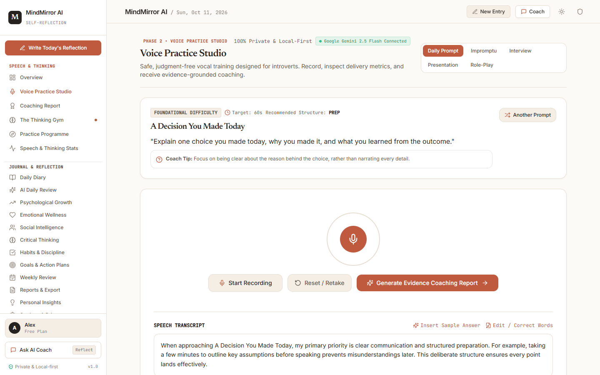
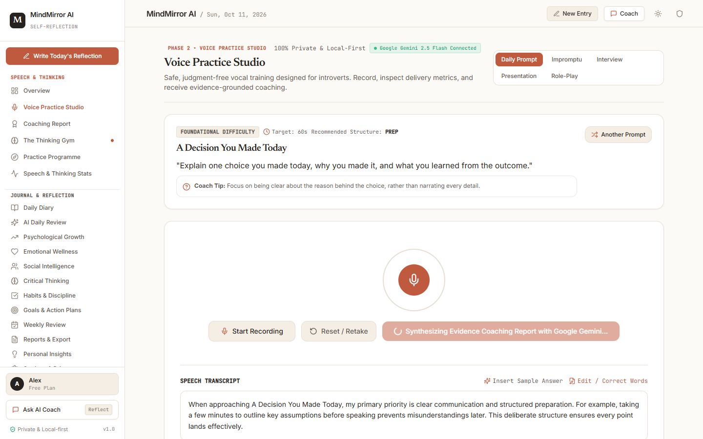
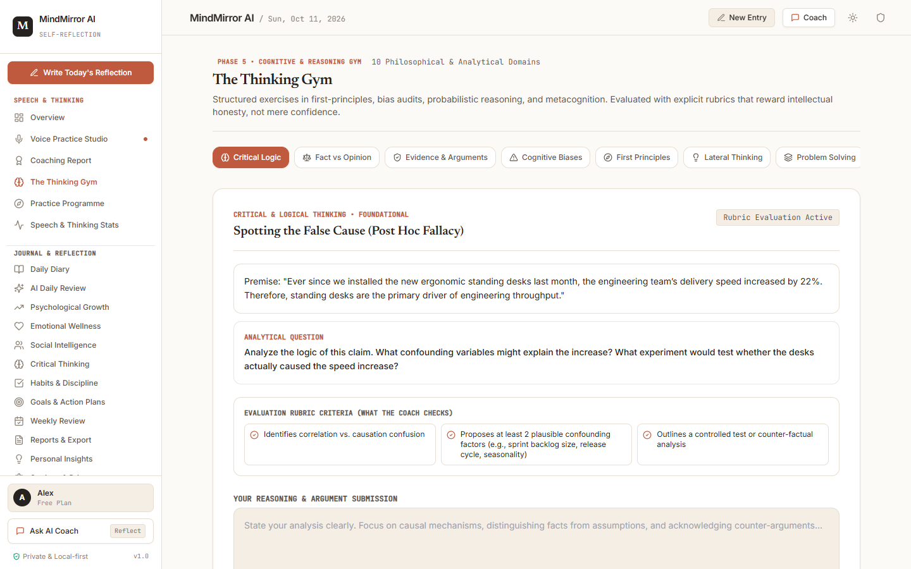
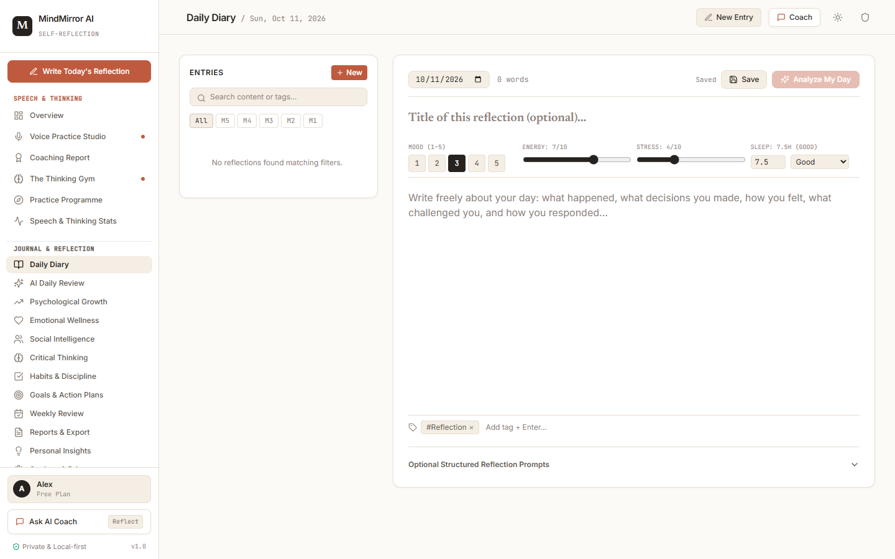
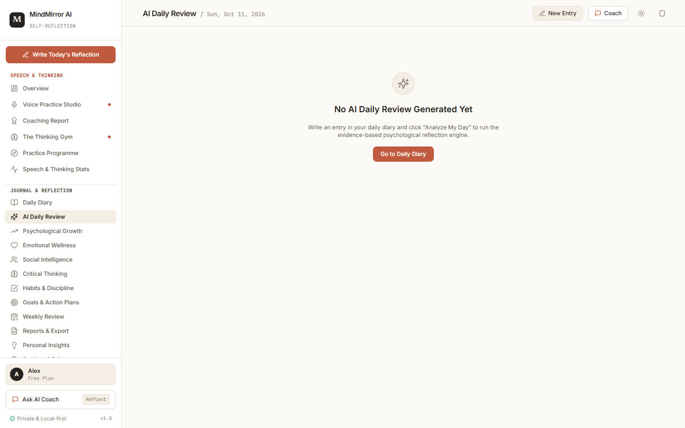
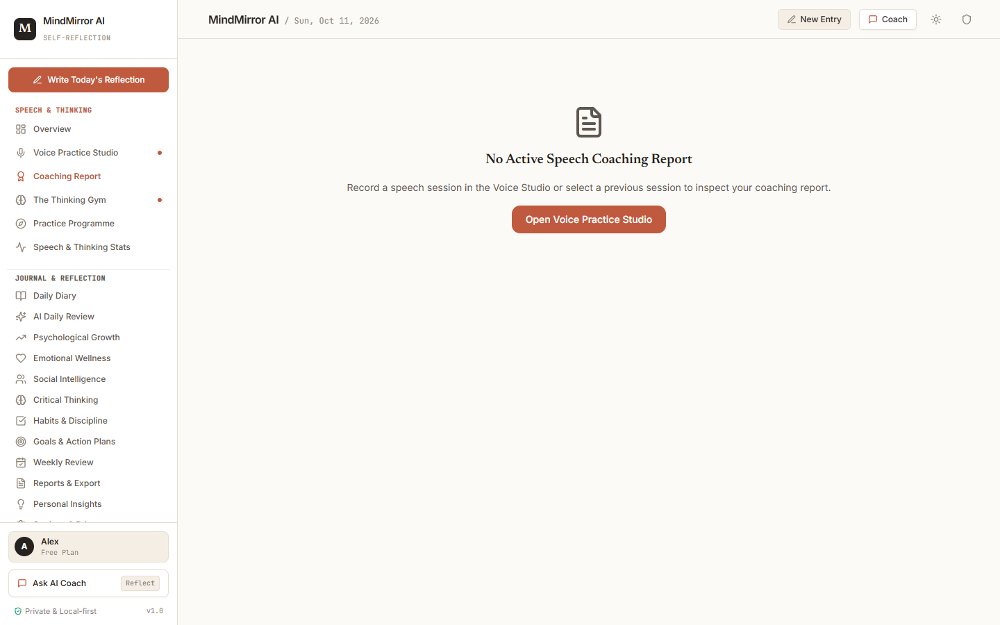

# MindMirror AI — Complete Beginner's Guidebook

Welcome to **MindMirror AI**! This guide is written for anyone getting started with MindMirror AI for the first time. You do not need to be a software developer or a public speaking expert to use this platform.

---

## Table of Contents
1. [Introduction](#1-introduction)
2. [Prerequisites](#2-prerequisites)
3. [Repository Structure](#3-repository-structure)
4. [How to Run the Website Locally](#4-how-to-run-the-website-locally)
5. [Navigating the User Interface](#5-navigating-the-user-interface)
6. [Step-by-Step Tutorials](#6-step-by-step-tutorials)
   - [Tutorial 1: Your First Speech Practice Session](#tutorial-1-your-first-speech-practice-session)
   - [Tutorial 2: Generating an Evidence Coaching Report](#tutorial-2-generating-an-evidence-coaching-report)
   - [Tutorial 3: Solving a Thinking Gym Challenge](#tutorial-3-solving-a-thinking-gym-challenge)
   - [Tutorial 4: Writing a Daily Reflection & AI Review](#tutorial-4-writing-a-daily-reflection--ai-review)
   - [Tutorial 5: Consulting the Conversational AI Coach](#tutorial-5-consulting-the-conversational-ai-coach)
7. [Inputs, Outputs & Expected Results](#7-inputs-outputs--expected-results)
8. [Practical Real-World Examples](#8-practical-real-world-examples)
9. [Common Errors & Quick Fixes](#9-common-errors--quick-fixes)
10. [Frequently Asked Questions (FAQ)](#10-frequently-asked-questions-faq)
11. [Glossary of Terms](#11-glossary-of-terms)
12. [Security, Privacy & Data Sovereignty](#12-security-privacy--data-sovereignty)
13. [Quick Links](#13-quick-links)

---

## 1. Introduction

**MindMirror AI** is a personal communication practice studio, cognitive reasoning gym, and psychological reflection journal created specifically for introverts and thoughtful communicators.

Unlike conventional public speaking apps that grade you on artificial charisma, MindMirror focuses on:
- **Private practice without judgment:** Practice speaking out loud when no one is watching.
- **Objective vocal metrics:** Track words per minute (WPM), pause durations, and filler words (*um*, *uh*, *like*, *you know*).
- **Structured thinking:** Master the **PREP framework** (Point, Reason, Example, Point) to deliver clear, impactful answers.
- **Cognitive fitness:** Solve structured exercises in 10 reasoning domains to audit your assumptions and intellectual honesty.
- **Privacy-first architecture:** Audio stays in your browser; API keys never leak; and data can be wiped at any time.

---

## 2. Prerequisites

To run MindMirror AI on your computer, you need:
1. **Node.js**: Version 18, 20, or newer (download free from [nodejs.org](https://nodejs.org)).
2. **Git**: Version control to clone the repository ([git-scm.com](https://git-scm.com)).
3. **A Modern Web Browser**: Google Chrome or Microsoft Edge recommended for live speech recognition streaming.
4. **Google Gemini API Key (Optional but Recommended)**: A free API key from [Google AI Studio](https://aistudio.google.com). *(The application functions even without an API key using the built-in deterministic heuristic fallback.)*

---

## 3. Repository Structure

Here is how the project files are organized:

```text
MindMirror-AI/
├── docs/                     # Documentation and screenshots
│   ├── screenshots/          # High-resolution genuine UI screenshots
│   ├── beginner-guide.md     # This comprehensive guide
│   ├── function-reference.md # Detailed breakdown of every feature
│   ├── screenshot-index.md   # Visual catalog of all screenshots
│   └── troubleshooting.md    # Common errors and resolutions
├── server/                   # Express backend server
│   ├── ai/                   # AI provider adapters (Gemini, Groq, Cerebras, Ollama, Heuristic)
│   ├── index.ts              # API routes (/api/speech/analyze, /api/ai/coach, etc.)
│   └── check-key.ts          # Key diagnostic utility
├── src/                      # React frontend application
│   ├── components/
│   │   ├── studio/           # Voice Practice Studio & Coaching Report
│   │   ├── thinking/         # The Thinking Gym
│   │   ├── program/          # Introvert Practice Programme
│   │   ├── progress/         # Speech & Thinking Stats
│   │   ├── diary/            # Daily Diary Journal
│   │   ├── review/           # AI Daily Review
│   │   ├── coach/            # Conversational Coach Drawer
│   │   └── common/           # Header, Sidebar, Safety Modal
│   ├── context/              # App state & LocalStorage sync
│   └── services/             # Audio metrics, local heuristics, and scoring
├── .env.example              # Template for server configuration
├── .gitignore                # Protects secrets and node_modules from Git
├── package.json              # Project dependencies & run scripts
└── vite.config.ts            # Vite bundler configuration (Port 3000)
```

---

## 4. How to Run the Website Locally

Follow these 4 simple steps to run the application on any device:

### Step 1: Clone the repository
Open PowerShell (Windows) or Terminal (Mac/Linux) and run:
```bash
git clone https://github.com/bhanuatla521-svg/MindMirror-AI-.git
cd MindMirror-AI-
```

### Step 2: Install dependencies
```bash
npm install
```

### Step 3: Setup your environment keys
Create your local `.env` file by copying the template:
```bash
cp .env.example .env
```
Open `.env` in any text editor and enter your Gemini API key:
```env
PORT=3001
PRIMARY_AI_PROVIDER=gemini
GEMINI_API_KEY=your_gemini_api_key_here
GEMINI_MODEL=gemini-2.5-flash
```

### Step 4: Start the application
Run the backend and frontend servers:
```bash
# Terminal 1: Start backend AI server
npm run server

# Terminal 2: Start the frontend website
npm run dev
```

Open **`http://localhost:3000`** in your browser. You will see the Overview Dashboard!

---

## 5. Navigating the User Interface



The application interface consists of three main regions:
1. **Persistent Sidebar (Left):**
   - **Speech & Thinking:** Voice Practice Studio, Coaching Report, The Thinking Gym, Practice Programme, and Stats.
   - **Journal & Reflection:** Daily Diary, AI Daily Review, 30 Growth Dimensions, Habits, Goals, and Settings.
   - **Ask AI Coach:** Opens the slide-out conversational drawer.
2. **Top Navigation Header:**
   - Section Title and today's date.
   - **New Entry:** Instant shortcut to write a journal entry.
   - **Coach:** Toggles the assistant.
   - **Sun/Moon Icon:** Toggles between light and dark visual themes.
   - **Shield Icon:** Accesses compassionate 24/7 crisis resources.
3. **Main Content Canvas:** Displays the active feature or practice workspace.

---

## 6. Step-by-Step Tutorials

### Tutorial 1: Your First Speech Practice Session



1. Click **Voice Practice Studio** in the left sidebar.
2. Choose a practice mode (e.g., **Daily Speaking Prompts**).
3. Read the prompt displayed on screen.
4. Click the terracotta **Start Recording** button.
5. If prompted by your browser, click **Allow** to enable your microphone.
6. Speak your thoughts for 30 to 60 seconds. Observe the audio volume meter moving as you speak.
7. Click **Stop Recording**.
8. Listen back to your recording using the audio player.
9. Review your physical delivery metrics: **Speaking Pace (WPM)**, **Filler Word Frequency**, and **Pause Count**.

*(Tip: If you do not have a microphone plugged in, click **Insert Sample Answer** to test the studio with sample data!)*



---

### Tutorial 2: Generating an Evidence Coaching Report



1. Once your practice transcript is recorded (or inserted via **Insert Sample Answer**), click **Generate Evidence Coaching Report →**.
2. Wait a few seconds for the Gemini engine (or local heuristic engine) to analyze your response.
3. The report will load displaying:
   - **PREP Structure Checkmarks:** Confirms whether you stated a clear Point, Reason, Example, and Point.
   - **Strengths with Verbatim Quotes:** Exact phrases that worked well.
   - **Ranked Weaknesses:** Prioritized areas for improvement with alternative phrasings.
   - **Rewritten PREP Model Response:** A gold-standard version of your answer.
   - **Targeted Micro-Drills:** 2 to 3 targeted exercises to practice next.

---

### Tutorial 3: Solving a Thinking Gym Challenge



1. Click **The Thinking Gym** in the left sidebar.
2. Select one of the 10 domain pills (e.g., **Critical Logic** or **Fact vs Opinion**).
3. Read the premise and the challenge question carefully.
4. Type your analysis into the response box. Focus on intellectual honesty and identifying hidden assumptions.
5. Click **Evaluate with Cognitive Rubric**.
6. The system evaluates your reasoning against objective pedagogical criteria, flagging confirmation biases and suggesting steel-manned counterarguments.

---

### Tutorial 4: Writing a Daily Reflection & AI Review



1. Click **Daily Diary** in the sidebar.
2. Adjust the sliders for your day's **Mood**, **Energy**, **Stress**, and **Sleep**.
3. Type what happened today and what thoughts are occupying your mind.
4. Click **Save Reflection**.
5. Click **AI Daily Review** in the sidebar to view an 8-dimension psychological synthesis of your day.



---

### Tutorial 5: Consulting the Conversational AI Coach



1. Click **Coach** in the top header or **Ask AI Coach** at the bottom of the sidebar.
2. A drawer will slide open on the right side of your screen.
3. Type any communication or personal reflection question (e.g., *"How can I introduce myself concisely in tomorrow's meeting using PREP?"*).
4. The coach will respond with practical, supportive, and Socratic guidance.

---

## 7. Inputs, Outputs & Expected Results

| Feature | What You Input | What MindMirror Calculates | Expected Result |
|---|---|---|---|
| **Voice Studio** | Voice audio or typed text | WPM, filler word count, audio RMS silence intervals | Precise delivery numbers and playback player |
| **Coaching Report** | Practice transcript | PREP alignment, cognitive load weaknesses | Actionable feedback with transcript quotes |
| **Thinking Gym** | Written philosophical response | Argument validity, assumption detection | Rubric score and counter-perspective |
| **Daily Diary** | Text reflection + 4 health sliders | Word count, emotional tone, tags | Stored reflection entry |
| **AI Review** | Saved diary entry | 8-dimension psychological review | Comprehensive growth breakdown |

---

## 8. Practical Real-World Examples

### Example: Using the PREP Framework for an Impromptu Work Question
- **Question:** *"Should we approve the new software vendor?"*
- **P (Point):** *"Yes, we should approve the vendor because their platform will cut customer response times by 30%."*
- **R (Reason):** *"Our support engineers are currently spending 15 hours a week on manual ticket routing."*
- **E (Example):** *"During last month's pilot with the billing team, resolution times dropped from 4 hours to under 45 minutes."*
- **P (Point):** *"Therefore, moving forward with this vendor directly solves our queue bottleneck."*

---

## 9. Common Errors & Quick Fixes

- **Browser says "Microphone blocked":** Click the padlock icon in your browser URL bar, set Microphone to **Allow**, and refresh.
- **Port 3000 is busy:** Run `Get-Process` or `lsof` and kill the previous Node process, or run on another port. See [Troubleshooting Guide](troubleshooting.md).
- **No Gemini API key available:** MindMirror includes a complete offline fallback engine; all calculations and reports still function locally!

---

## 10. Frequently Asked Questions (FAQ)

**Q: Are my voice recordings stored on a public cloud server?**  
A: No. Voice recordings are processed locally in your browser memory. You can permanently delete the audio at any time by clicking **Delete Audio (Privacy)**.

**Q: Can I use MindMirror on my phone?**  
A: Yes! Run `npx vite --host` on your computer and open the Network URL (`http://192.168.x.x:3000`) in your phone's browser while on the same Wi-Fi.

**Q: Does MindMirror diagnose psychological disorders?**  
A: No. MindMirror strictly provides pedagogical, evidence-based communication coaching and structured self-reflection. It never infers medical conditions.

---

## 11. Glossary of Terms

- **WPM (Words Per Minute):** Speaking speed. The optimal conversational target band is **130–165 WPM**.
- **Filler Words:** Habitual speech pauses such as *um*, *uh*, *like*, *you know*, *basically*.
- **PREP Framework:** A 4-step communication model: **Point**, **Reason**, **Example**, **Point**.
- **Socratic Inquiry:** Thoughtful, open-ended questioning that helps you discover answers independently.
- **Local Heuristic Fallback:** Built-in algorithm that performs analysis without internet access.

---

## 12. Security, Privacy & Data Sovereignty

- **Server-Side API Key Security:** Keys are loaded via `.env` on port 3001 and never sent to client browsers.
- **Local-First Storage:** Entries are stored in your browser's private LocalStorage.
- **Data Export:** Export your entire history at any time as JSON or CSV from **Reports & Export**.
- **Wipe All Data:** Clear everything with one click in **Settings & Privacy**.

---

## 13. Quick Links

- [User-Facing Feature Reference](feature-reference.md)
- [Code-Level Function Reference](function-reference.md)
- [Screenshot Catalog Index](screenshot-index.md)
- [System Architecture Specification](architecture.md)
- [Testing & Quality Assurance Guide](testing.md)
- [Troubleshooting Guide](troubleshooting.md)
