# MindMirror AI — Comprehensive Feature Reference

This reference documents every user-facing feature, workflow, and interactive control in MindMirror AI with embedded genuine screenshots captured from the running application.

---

## Feature Catalog
1. [Overview Dashboard](#feature-overview-dashboard)
2. [Voice Practice Studio](#feature-voice-practice-studio)
3. [Sample Answer & Live Metrics Engine](#feature-sample-answer--live-metrics-engine)
4. [Evidence-Based Coaching Report](#feature-evidence-based-coaching-report)
5. [The Thinking Gym](#feature-the-thinking-gym)
6. [Introvert Practice Programme](#feature-introvert-practice-programme)
7. [Speech & Thinking Stats](#feature-speech--thinking-stats)
8. [Daily Diary Journaling Canvas](#feature-daily-diary-journaling-canvas)
9. [AI Daily Review Synthesis](#feature-ai-daily-review-synthesis)
10. [Psychological Growth Dashboard](#feature-psychological-growth-dashboard)
11. [Emotional Wellness Tracker](#feature-emotional-wellness-tracker)
12. [Social Intelligence Studio](#feature-social-intelligence-studio)
13. [Critical Thinking Toolkit](#feature-critical-thinking-toolkit)
14. [Habits & Discipline Matrix](#feature-habits--discipline-matrix)
15. [Goals & Action Plans](#feature-goals--action-plans)
16. [Weekly Review Retrospective](#feature-weekly-review-retrospective)
17. [Reports & Data Export](#feature-reports--data-export)
18. [Personal Insights Engine](#feature-personal-insights-engine)
19. [Settings & Privacy Center](#feature-settings--privacy-center)
20. [Conversational AI Coach Drawer](#feature-conversational-ai-coach-drawer)
21. [Visual Theme & Dark Mode](#feature-visual-theme--dark-mode)
22. [Compassionate Crisis Safeguard Modal](#feature-compassionate-crisis-safeguard-modal)

---

### Feature: Overview Dashboard

**Screenshot:**  

**Purpose:** Serves as the central operational cockpit of MindMirror AI, displaying today's Stoic quote, quick reflective inquiry pills, health metric summaries, actionable micro-commitments, and quick shortcuts to speech and cognitive training modules.

**Location:** Default route on app load (`activeTab: 'overview'`), or by clicking **Overview** at the top of the sidebar.

**Why it matters:** Eliminates the blank-page paralysis experienced by introspective communicators by providing structured entry points and daily cognitive priming.

**Prerequisites:** None. Works out of the box with default prompts.

**How to use it:**
1. Check your **Latest Self-Reported Metrics** card (Mood, Energy, Stress, Sleep).
2. Click any prompt chip (e.g., *"What patterns appear in my last 30 days?"* or *"What could I have done differently?"*).
3. Read the generated Socratic reflection guidance in the reflection card.
4. Click **+ Add to Actions** to schedule behavioral micro-commitments for tomorrow.
5. Click any module card (**Voice Practice Studio**, **The Thinking Gym**, or **Practice Programme**) to launch focused training.

**Inputs:** Single-click interaction on prompt chips, action checkmark toggles, or search inquiry text.

**Expected output:** Contextual Socratic inquiry advice card, updated task checklists, and immediate module navigation.

**Example:** Selecting *"What patterns appear in my last 30 days?"* produces a structured prompt challenging the user to separate verifiable events from emotional assumptions.

**How it works:** React component `OverviewDashboard.tsx` aggregates entries and dimensions from `useApp()` context, calculating real-time averages and rendering interactive cards.

**Related functions:** `saveEntry()`, `sendCoachMessage()`, `turnIntoAction()`, `calculateRadarData()`.

**Limitations:** Requires at least one saved diary entry to calculate multi-day mood and sleep trend graphs.

**Troubleshooting:** If the Socratic reflection card displays fallback text, ensure the backend server is running on `http://localhost:3001`.

---

### Feature: Voice Practice Studio

**Screenshot:**  

**Purpose:** A private, zero-judgment audio recording studio that measures physical delivery mechanics (words per minute, filler words, audio pause intervals) and captures live speech transcripts.

**Location:** **Speech & Thinking** &rarr; **Voice Practice Studio** (`activeTab: 'studio'`).

**Why it matters:** Introverted speakers often experience high anxiety when practicing in front of peers. The Voice Studio offers a safe, solo laboratory to establish baseline speaking fluency.

**Prerequisites:** Microphone permission granted in the browser.

**How to use it:**
1. Select a practice mode from the top tabs (*Daily Prompts*, *Impromptu*, *Interview*, *Presentation*, or *Roleplay*).
2. Choose a difficulty level (*Foundational*, *Intermediate*, or *Advanced*).
3. Click the terracotta **Start Recording** button.
4. Speak your answer into your microphone while monitoring the real-time audio volume visualizer.
5. Click **Stop Recording** when finished.
6. Play back the audio using the built-in media player, or review the editable transcript text.

**Inputs:** Audio stream via browser `navigator.mediaDevices.getUserMedia()`; optional manual text edits in the transcript box.

**Expected output:** Waveform volume activity meter, recorded audio playback controls, editable transcript, and calculated physical delivery metrics (Pace, Fillers, Pauses).

**Example:** Recording an answer to *"Describe a time you handled unexpected feedback"* calculates 135 WPM pace, 2 filler words, and 4 natural pauses.

**How it works:** Uses HTML5 `MediaRecorder` and `AudioContext` with an `AnalyserNode` for live RMS level tracking. Real-time transcription is processed via the Web Speech API.

**Related functions:** `calculateSpeechMetrics()`, `analyzeSpeechSession()`.

**Limitations:** Speech recognition streaming depends on browser support for the Web Speech API (Google Chrome and Microsoft Edge recommended).

**Troubleshooting:** If "Microphone access blocked" appears, click the URL padlock icon in your browser and toggle Microphone to **Allow**.

---

### Feature: Sample Answer & Live Metrics Engine

**Screenshot:**  

**Purpose:** Automatically injects a calibrated sample response into the Voice Practice Studio to demonstrate delivery metrics calculation without requiring microphone hardware.

**Location:** Inside **Voice Practice Studio**, top right of the transcript editor box (**Insert Sample Answer** button).

**Why it matters:** Ensures immediate accessibility on devices without microphones, during software audits, and for users testing the platform in public spaces.

**Prerequisites:** Voice Practice Studio active tab open.

**How to use it:**
1. Navigate to **Voice Practice Studio**.
2. Click **Insert Sample Answer**.
3. Observe the calculated metrics: **132 WPM** speaking pace, **1.5% filler word density**, and **33-second** duration.
4. Manually edit any words in the transcript box to observe real-time metric recalculation.

**Inputs:** Click event on the **Insert Sample Answer** button.

**Expected output:** Fully populated transcript box, recalculated delivery meters, and an activated **Generate Evidence Coaching Report** button.

**Example:** Injects a structured 73-word answer addressing unexpected executive questions.

**How it works:** Triggers `calculateSpeechMetrics()` with verified sample token arrays, updating component state and enabling the coaching generation pipeline.

**Related functions:** `calculateSpeechMetrics()` in `src/services/speechAnalysisService.ts`.

**Limitations:** Uses simulated audio timing intervals for the inserted sample response.

---

### Feature: Evidence-Based Coaching Report

**Screenshot:**  

**Purpose:** Generates comprehensive, empirical rhetorical evaluations analyzing argument structure using the **PREP framework** (Point, Reason, Example, Point).

**Location:** **Speech & Thinking** &rarr; **Coaching Report** (`activeTab: 'speech_report'`), or click **Generate Evidence Coaching Report** in the Voice Studio.

**Why it matters:** Traditional speech feedback is subjective and vague. MindMirror provides objective evidence: exact quotes, ranked cognitive friction points, and an explicit model rewrite.

**Prerequisites:** A completed speech practice recording or populated transcript.

**How to use it:**
1. After recording or inserting a sample answer, click **Generate Evidence Coaching Report →**.
2. Review the **PREP Structure Assessment** checkmarks:
   - Main Point Identified
   - Reason & Mechanism Explained
   - Concrete Example Provided
   - Conclusion Clarity
3. Inspect **Strengths** with verbatim quotes and **Ranked Weaknesses** with listener impact explanations.
4. Read the **Clearer Alternative Response (PREP Model)** rewrite.
5. Click **Launch Retest Challenge** to immediately re-record targeting the recommended delivery criteria.

**Inputs:** Practice transcript text, physical delivery metrics (WPM, fillers, duration, pauses).

**Expected output:** Evidence-grounded coaching report card, PREP compliance rubric, model response rewrite, and confidence score.

**Example:** Flags that a response lacked a concrete example and offers a rewritten version anchoring the claim in a 45-minute resolution metric.

**How it works:** Dispatches a structured JSON prompt to the Express backend (`/api/speech/analyze`), querying `gemini-2.5-flash` with strict Zod schema validation. Automatically cascades to Groq, Cerebras, Ollama, or deterministic local heuristics if external APIs are unavailable.

**Related functions:** `analyzeSpeechSession()`, `generateLocalSpeechCoachingReport()`.

**Limitations:** AI analysis requires an active backend server connection or relies on the local heuristic engine.

---

### Feature: The Thinking Gym

**Screenshot:**  

**Purpose:** A cognitive workout laboratory featuring exercises across 10 analytical domains, evaluated with rubrics that reward justified conclusions, bias awareness, and intellectual honesty over mere confidence.

**Location:** **Speech & Thinking** &rarr; **The Thinking Gym** (`activeTab: 'thinking'`).

**Why it matters:** Clear speaking requires clear thinking. Training the cognitive foundation ensures communicators have robust arguments before uttering a word.

**10 Analytical Domains:**
1. *Critical & Logical Thinking* (false cause fallacy audits)
2. *Fact vs. Opinion & Assumption Detection*
3. *Evidence Evaluation & Argument Construction* (Claim-Evidence-Reasoning)
4. *Cognitive Biases & Alternative Explanations*
5. *First-Principles & Systems Thinking*
6. *Creativity & Lateral Thinking* (inversion models)
7. *Problem-Solving & Decision-Making* (reversible vs. irreversible decisions)
8. *Probabilistic Reasoning & Uncertainty* (asymmetric risk)
9. *Perspective-Taking & Respectful Disagreement* (steel-manning)
10. *Metacognition & Self-Reflection* (auditing defensive reactivity)

**How to use it:**
1. Click any category tab in the horizontal selector.
2. Read the scenario premise and challenge prompt.
3. Write your analytical reasoning in the response editor.
4. Click **Evaluate with Cognitive Rubric**.
5. Review the rubric evaluation: intellectual honesty score, assumption flags, and steel-manned counterarguments.

**Inputs:** Selected category tab, written reasoning response.

**Expected output:** Multi-criteria rubric evaluation card with concrete suggestions for strengthening argument rigor.

**Related functions:** `evaluateThinkingExercise()`, `saveThinkingSubmission()`.

---

### Feature: Introvert Practice Programme

**Screenshot:**  
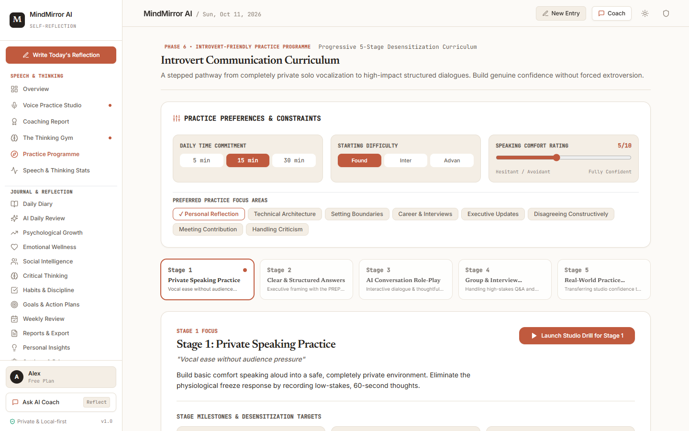

**Purpose:** A 5-stage progressive desensitization pathway that scaffolds vocal confidence through graduated exposure challenges.

**Location:** **Speech & Thinking** &rarr; **Practice Programme** (`activeTab: 'program'`).

**Why it matters:** Radical speaking exposure often overwhelms introverts. A stepped curriculum ensures gradual, durable confidence growth without burnout.

**The 5 Stages:**
- **Stage 1: Solo Comfort:** Private vocalization exercises in low-stakes reflection.
- **Stage 2: Clear Structure:** Mastering the PREP and STAR frameworks.
- **Stage 3: AI Roleplay:** Tolerating conversational silence and assertive inquiry.
- **Stage 4: Group Simulations:** Cross-functional meeting and interview syncs.
- **Stage 5: Real-World Transfer:** Taking studio skills into everyday conversations.

**Inputs:** Daily available time selector (5 min, 15 min, 30 min), difficulty dropdown, task completion toggles.

**Expected output:** Customized daily practice task list with progress percentages.

**Related functions:** `updateCurriculumState()`.

---

### Feature: Speech & Thinking Stats

**Screenshot:**  
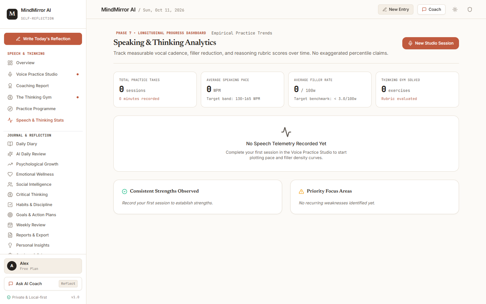

**Purpose:** Visual longitudinal dashboard displaying speaking pacing (WPM), filler word reduction trends, recurrent strengths, and session practice history.

**Location:** **Speech & Thinking** &rarr; **Speech & Thinking Stats** (`activeTab: 'speech_progress'`).

**Why it matters:** Provides mathematical evidence of speaking improvement across weeks and months, reinforcing self-efficacy.

**Metrics:**
- Pacing line chart against the optimal conversational target band (130–165 WPM).
- Filler word frequency reduction bars.
- Recurrent strengths counter.
- Interactive session log with one-click report relaunchers.

**Related functions:** `useApp()` speechReports selector.

---

### Feature: Daily Diary Journaling Canvas

**Screenshot:**  

**Purpose:** A serene, distraction-free psychology journal for logging daily experiences, self-reported health markers, and reflective commentary.

**Location:** **Journal & Reflection** &rarr; **Daily Diary** (`activeTab: 'diary'`).

**Inputs:** Date picker, Mood slider (1–5), Energy slider (1–10), Stress slider (1–10), Sleep slider (hours), title, long-form content, and topic tags.

**Expected output:** Stored entry in LocalStorage, ready for AI Daily Review.

**Related functions:** `saveEntry()`, `deleteEntry()`, `checkSafetyTriggers()`.

---

### Feature: AI Daily Review Synthesis

**Screenshot:**  

**Purpose:** Psychological review synthesis engine that decomposes diary entries into an 8-dimension structured rubric (A through H).

**Location:** **Journal & Reflection** &rarr; **AI Daily Review** (`activeTab: 'review'`).

**The 8 Dimensions:**
- **A:** Executive Summary & Emotional Theme.
- **B:** Cognitive Distortion & Bias Detection.
- **C:** Decision-Making Quality & Rationale.
- **D:** Social & Interpersonal Dynamics.
- **E:** Habits & Behavioral Discipline.
- **F:** Energy, Sleep, and Stress Physical Correlations.
- **G:** Actionable Tomorrow Recommendations.
- **H:** Psychological Growth Dimension Delta Scoring.

**Related functions:** `analyzeEntry()`, `generateLocalAIReview()`.

---

### Feature: Psychological Growth Dashboard

**Screenshot:**  
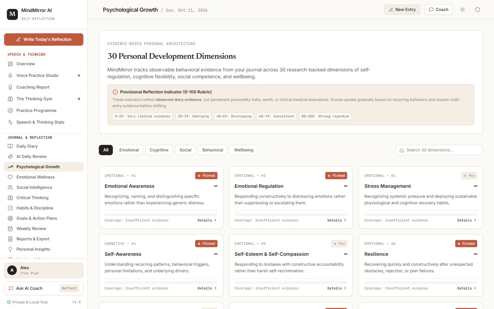

**Purpose:** Maps reflective entries across **30 psychological growth dimensions** (e.g., Emotional Self-Regulation, Intellectual Humility, Boundary Setting, Stoic Resilience).

**Location:** **Journal & Reflection** &rarr; **Psychological Growth** (`activeTab: 'growth'`).

**Related functions:** `recomputeDimensionsFromUserEntries()`.

---

### Feature: Emotional Wellness Tracker

**Screenshot:**  
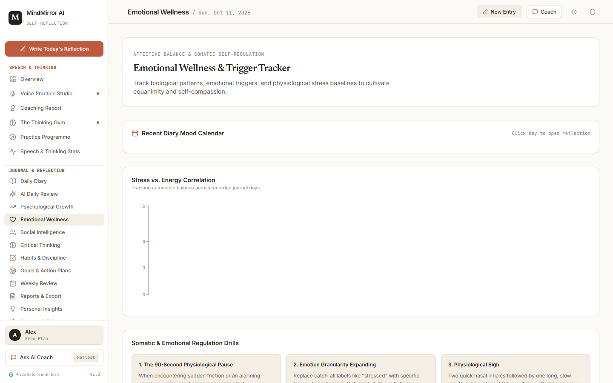

**Purpose:** Dedicated dashboard tracking emotional states, recurring mood triggers, and evidence-based regulation techniques.

**Location:** **Journal & Reflection** &rarr; **Emotional Wellness** (`activeTab: 'emotions'`).

---

### Feature: Social Intelligence Studio

**Screenshot:**  
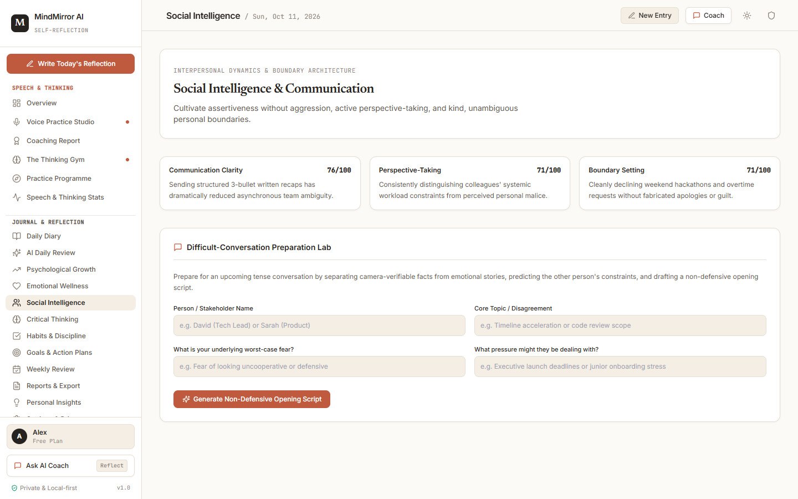

**Purpose:** Space for introverts to audit social energy battery depletion, reflect on conversational boundaries, and practice assertiveness.

**Location:** **Journal & Reflection** &rarr; **Social Intelligence** (`activeTab: 'social'`).

---

### Feature: Critical Thinking Toolkit

**Screenshot:**  
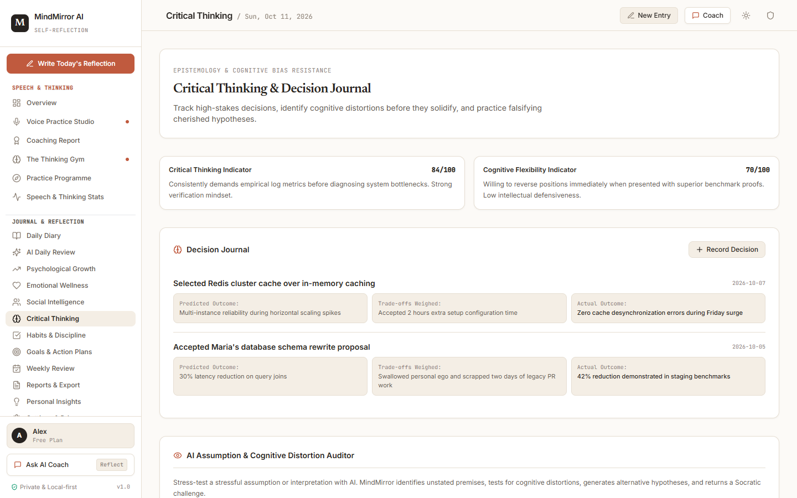

**Purpose:** Interactive worksheets for identifying cognitive distortions (all-or-nothing thinking, catastrophizing, mind-reading) and testing alternative hypotheses.

**Location:** **Journal & Reflection** &rarr; **Critical Thinking** (`activeTab: 'critical'`).

---

### Feature: Habits & Discipline Matrix

**Screenshot:**  
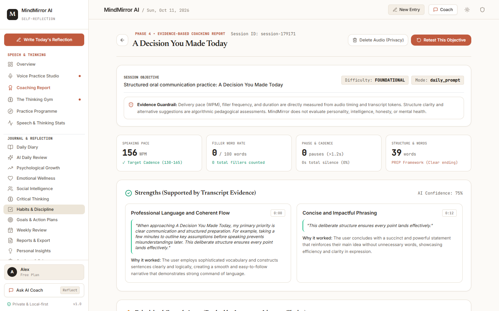

**Purpose:** Habit consistency matrix for building routines, tracking consecutive day streaks, and minimizing start friction.

**Location:** **Journal & Reflection** &rarr; **Habits & Discipline** (`activeTab: 'habits'`).

**Related functions:** `addHabit()`, `toggleHabitDate()`, `deleteHabit()`.

---

### Feature: Goals & Action Plans

**Screenshot:**  
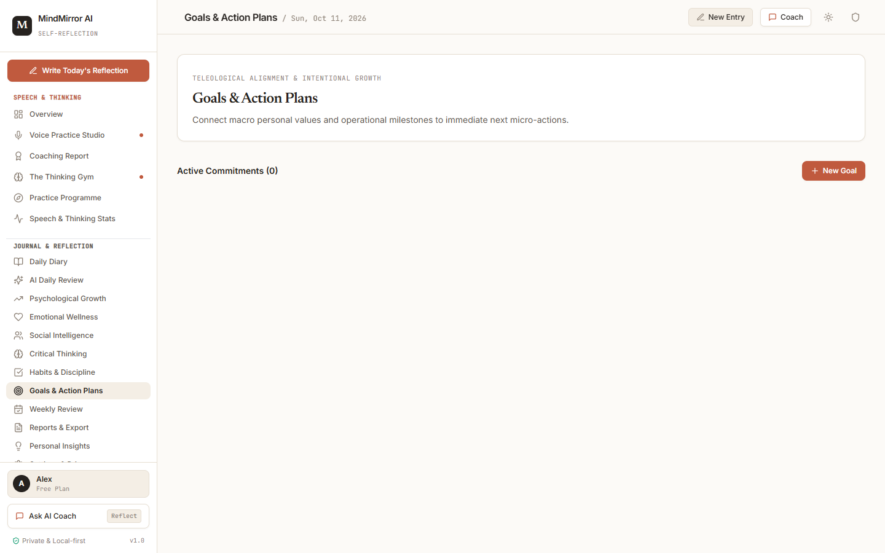

**Purpose:** Decomposes long-term aspirational goals into quarterly objectives, measurable milestones, and daily micro-actions.

**Location:** **Journal & Reflection** &rarr; **Goals & Action Plans** (`activeTab: 'goals'`).

**Related functions:** `addGoal()`, `updateGoal()`, `turnIntoAction()`.

---

### Feature: Weekly Review Retrospective

**Screenshot:**  
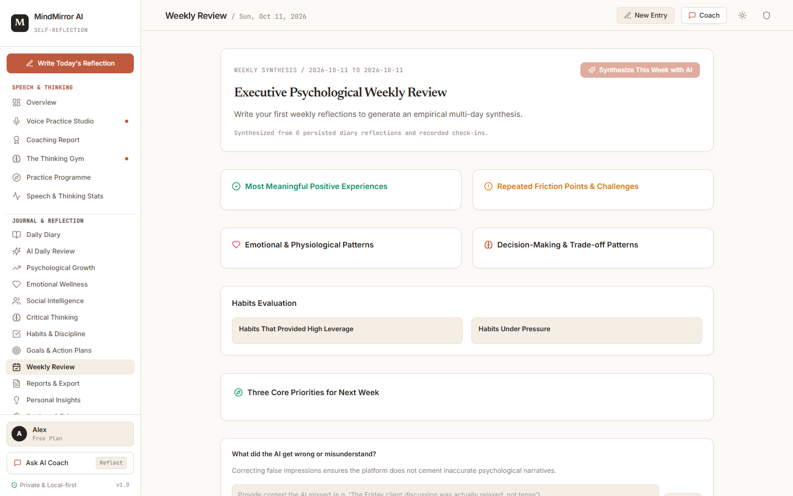

**Purpose:** 7-day retrospective engine that synthesizes all diary entries and speech sessions from the past week into achievements, recurrent obstacles, and priorities.

**Location:** **Journal & Reflection** &rarr; **Weekly Review** (`activeTab: 'weekly'`).

**Related functions:** `generateAIWeeklyReview()`.

---

### Feature: Reports & Data Export

**Screenshot:**  
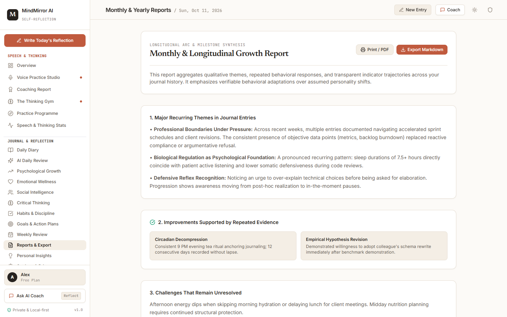

**Purpose:** Data portability hub allowing users to compile printable PDF reports and download raw reflection history as JSON or CSV files.

**Location:** **Journal & Reflection** &rarr; **Reports & Export** (`activeTab: 'reports'`).

**Related functions:** `exportData('json')`, `exportData('csv')`.

---

### Feature: Personal Insights Engine

**Screenshot:**  
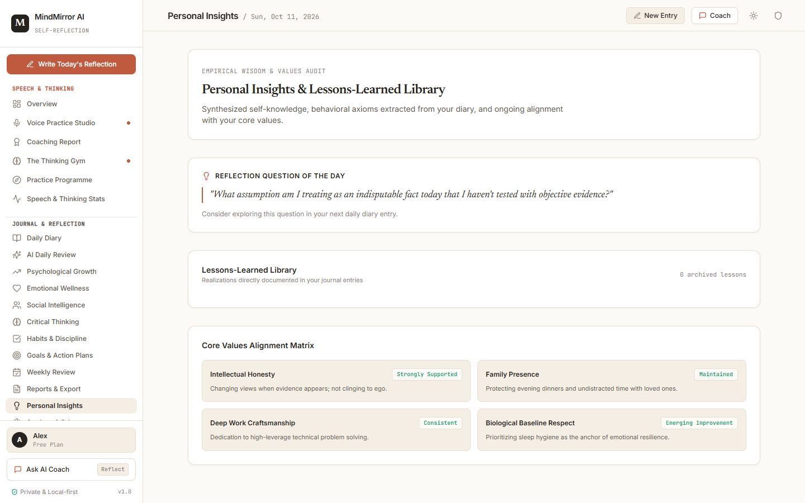

**Purpose:** Algorithmic correlation finder that identifies relationships between physical sleep, stress levels, vocal pacing, and confidence ratings.

**Location:** **Journal & Reflection** &rarr; **Personal Insights** (`activeTab: 'insights'`).

---

### Feature: Settings & Privacy Center

**Screenshot:**  
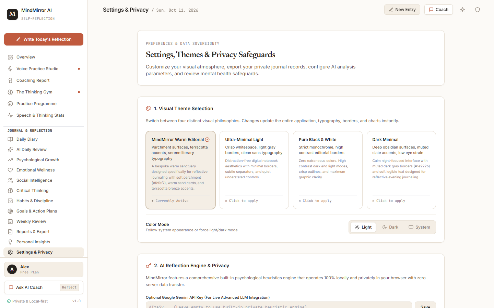

**Purpose:** Local privacy control center for switching AI providers (Gemini, Groq, Cerebras, Ollama, Heuristic), auditing API quotas, resetting sample data, or wiping browser storage.

**Location:** **Journal & Reflection** &rarr; **Settings & Privacy** (`activeTab: 'settings'`).

**Related functions:** `setTheme()`, `setColorMode()`, `wipeAllData()`, `resetToSampleData()`.

---

### Feature: Conversational AI Coach Drawer

**Screenshot:**  

**Purpose:** Slide-out conversational AI mentor available on every screen for clarifying thoughts, practicing arguments, or asking communication questions.

**Location:** Click **Ask AI Coach** in the sidebar, or click **Coach** in the top header.

**Related functions:** `sendCoachMessage()`, `isCoachOpen`.

---

### Feature: Visual Theme & Dark Mode

**Screenshot:**  
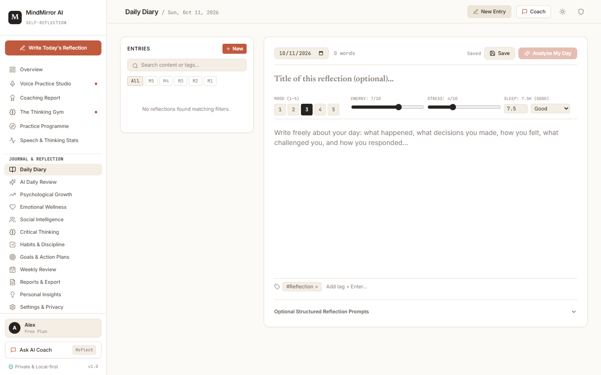

**Purpose:** Seamless color scheme switcher supporting Light, Dark, and System modes, with 4 aesthetic palettes (*MindMirror Warm Editorial*, *Ultra-Minimal Light*, *Pure Black & White*, and *Dark Minimal*).

**Location:** Sun/Moon button in the top header, or inside **Settings & Privacy**.

**Related functions:** `setColorMode()`, `setTheme()`.

---

### Feature: Compassionate Crisis Safeguard Modal

**Screenshot:**  
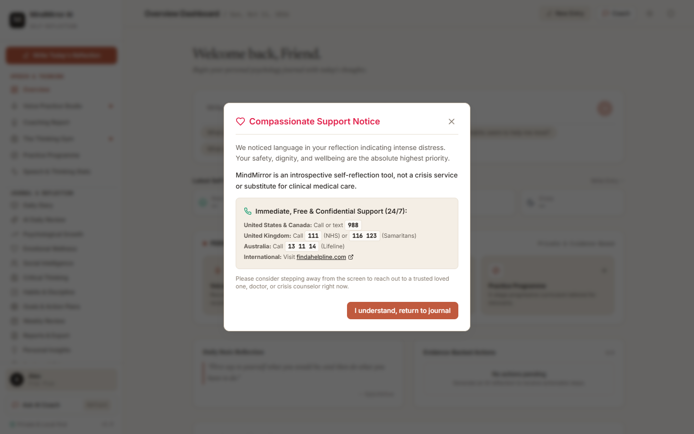

**Purpose:** Immediate compassionate interceptor that displays free, confidential 24/7 crisis resources (988 in US/Canada, 111 in UK, 13 11 14 in Australia) whenever acute distress language is detected.

**Location:** Click the **Shield icon** in the top header, or triggers automatically if severe distress phrases appear in any reflection.

**Related functions:** `checkSafetyTriggers()`, `setSafetyAlertOpen()`.
